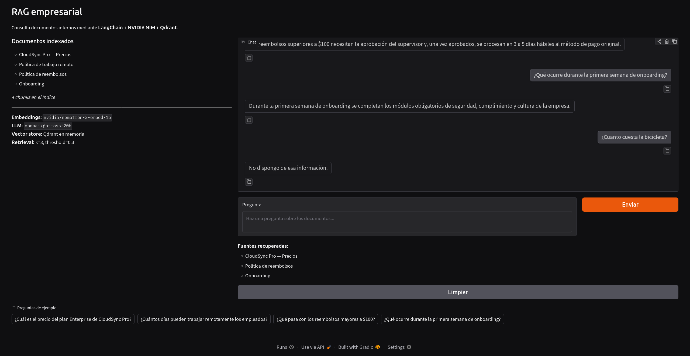

# Respuestas del workshop RAG
Escribe aquí tus respuestas con tus propias palabras. Pega tablas, resultados y enlaces a las capturas de `evidencias/`.

---

# Bloque 0 · Teoría

## T1 · Cuántos nodos viven en cada capa

_Evidencia:_ 

_Mi respuesta / análisis:_ Porque la complejidad algoritmica depende de los nodos visitados entonces entre menos nodos se visiten menos tiempo demora. Asi las capas superiores funcionan como ruta rapida hacia zonas inferiores.

## T2 · ef, k y el tamaño de la cola

_Evidencia:_ …

_Mi respuesta / análisis:_ 
1. Cuando la cantidad de candidatos ef es menor que los candidatos solicitados k, simplemente no hay k candidatos que elegir. 
2. Empieza con _ef = 2* k_ y si el _recall_ es insuficiente subelo.
3. Puedes cambiar el _ef_ utilizado para el esfuerzo en la busqueda y en teoria y si la implementacion lo permite puedes cambiar *ef_construction* lo cual modificaria la calidad de los enlaces o el _recall_. Pero esto no es apropiado e introduce ambiguedad en la medicion del _recall_ entonces en definitiva deberiamos cambiar _ef_ y no *ef_construction*.

## T3 · Inserción frente a búsqueda

_Evidencia:_ 

| Comparacion | Inserción | Búsqueda |
| --- | --- | --- | 
|¿Se sortea la capa? | Si, basado en una distribucion exponencial | No, cada nodo ya tiene capa asignada |
|Valor de ef en las capas altas | _ef = 1_ mientras no se haya llegado a la capa maxima del nodo insertado, _ef = ef_construction_ despues | Excepto en la capa 0 _ef = 1_ segun la guia, en la capa 0 se recomienda _ef=2*k_ |
|Parámetro de la fase principal | _mL≈ 1 / ln(16) =controla la distribucion_, *ef_construction=candidatos del greedy en construccion*, _M=mejore candidatos_ | _ef=candidatos de la busqueda_, _k=mejores candidatos seleccionados_, _query_vector_ |
|¿Modifica el índice? | Si | No |

_Mi respuesta / análisis:_ *vectorstore.add_documents(...)* en insercion y *retriever.invoke(...)* en busqueda 

## T4 · El invariante de FAISSVectorStore

_Evidencia:_ …

_Mi respuesta / análisis:_
1. Esta busqueda ahora da un error porque si la base de datos vectorial da el indice _3_, y el proceso de busqueda termina llamando a _self.documents_ en esa posicion estas llamando un indice invalido y arroja error.

2. Si hay un error silencios es porque se retorno -1 debido a que no se pudo llenar los k candidatos, y por lo tanto el problema esta en el tercer indice que al extraer de _self.document_ seria igual al ultimo document insertado. 

3. La base de datos vectorial Qdrant se encarga de manjer las mutaciones de forma nativa, mientras que FAISS no tiene las operaciones que hacen falta para esto.

## T5 · El costo de la fuerza bruta

_Mi respuesta / análisis:_ 
1. Se tiene: $738 \cdot 10^{6} \frac{\text{multipliaciones}}{\text{consulta}}$ y $100 \frac{consulta}{segundo}$, entonces esto es igual a $738 \cdot 10^{8} \frac{\text{multipliaciones}}{\text{segundo}}$

2. Esta cantidad de opearciones por segundo $738 \cdot 10^{8} \frac{\text{multipliaciones}}{\text{segundo}}$ son computacionalmente costosas.

3. ANN sacrifica un poco de precision para ganar ordenes de magnitud en eficiencia.

---

# Bloque A · App RAG empresarial

## A1 · Ejecuta la app RAG de punta a punta

_Evidencia:_ 

_Mi respuesta / análisis:_

### Tabla de preguntas

| indice | Pregunta | Respuesta | Existe contexto |
| --- | --- | --- | --- |  
| 1 | ¿Cuál es el precio del plan Enterprise de CloudSync Pro? | El plan Enterprise de CloudSync Pro cuesta $49/mes por usuario con compromiso anual. |Si |
| 2 | ¿Cuántos días a la semana pueden trabajar remotamente los empleados? | Los empleados pueden trabajar remotamente hasta 3 días por semana. |Si |
| 3 | ¿Qué pasa con los reembolsos mayores a $100? | Los reembolsos superiores a $100 necesitan la aprobación del supervisor y, una vez aprobados, se procesan en 3 a 5 días hábiles al método de pago original. |Si |
| 4 | ¿Qué ocurre durante la primera semana de onboarding? | Durante la primera semana de onboarding se completan los módulos obligatorios de seguridad, cumplimiento y cultura de la empresa. |Si |
| 5 | ¿Cuanto cuesta la bicicleta?  | No dispongo de esa información. |No |

## A2 · Tu propio corpus de documentos

_Evidencia:_ …

_Mi respuesta / análisis:_

| Pregunta | Respuesta | ¿Se responde con el documento? |
| --- | --- | --- |
| ¿Cuánto cuesta el plan Básico de CloudSync Pro y cuánto almacenamiento incluye? | El plan Básico de CloudSync Pro cuesta $9/mes por usuario y ofrece 100 GB de almacenamiento por usuario. | Sí |
| ¿Con cuántos días de anticipación deben solicitarse las vacaciones? | 10 días. | Sí |
| ¿Cuánto tiempo permanece vigente el enlace para restablecer una contraseña? | El enlace vence después de 30 minutos. | Sí |
| ¿Durante cuántos días se conservan las versiones de los archivos en el servicio de copias de seguridad? | Se conservan durante 30 días. | Sí |
| ¿Cuáles son los pasos para reportar un incidente de TI? | Para reportar un incidente de TI debes registrar el problema en el portal interno de TI, indicando los sistemas afectados y la fecha de inicio, y adjuntar una descripción detallada del error. Luego, el equipo de TI clasificará la prioridad y confirmará la recepción del reporte. Es importante seguir las instrucciones que te envíen y evitar realizar reparaciones no autorizadas. Finalmente, recibirás una actualización cuando el servicio haya sido restablecido. | Sí |
| ¿Cuál es el salario mensual promedio de los empleados de la empresa? | No dispongo de esa información. | No |
| ¿Cuántos clientes tiene actualmente CloudSync Pro? | No dispongo de esa información. | No |

No tuve necesidad de ajustar el `chunksize` porque mi servicio de generacion tiene una ventana de contexto suficientemente buena, el modelo de embedding es capas de representar la complejidad del tamano de los chunks y en general funciono correctamente.

## A3 · Ingeniería del prompt (antes y después)

_Evidencia:_

Primero las preguntas y sus respuestas con el pipeline como viene por defecto

| tipo | pregunta | respuesta |
| --- | --- | --- |
| Facil | ¿Cuánto cuesta el plan Básico de CloudSync Pro y cuánto almacenamiento incluye? | El plan Básico de CloudSync Pro cuesta $9/mes por usuario y ofrece 100 GB de almacenamiento por usuario. |
| Ambigua | ¿Que deben hacer los empleados? | Los empleados deben usar autenticación multifactor, no compartir credenciales ni almacenar información confidencial en dispositivos personales sin autorización, reportar incidentes de seguridad al equipo de TI de inmediato y registrarlos en el portal interno siguiendo los pasos indicados, solicitar vacaciones con al menos 10 días de anticipación y notificar ausencias por enfermedad antes del inicio de la jornada. |
| Fuera de contexto | ¿Cuanto cuestan los bananos? |  No dispongo de esa información.|

Despues de las modificaciones

| tipo | pregunta | respuesta |
| --- | --- | --- |
| Facil | ¿Cuánto cuesta el plan Básico de CloudSync Pro y cuánto almacenamiento incluye? | [CloudSync Pro — Plan Básico] El plan Básico cuesta $9 al mes por usuario y ofrece 100 GB de almacenamiento por usuario. | 
| Ambigua | ¿Que deben hacer los empleados? | [Política de Seguridad de la Información] los empleados deben usar autenticación multifactor, no compartir credenciales y reportar incidentes de seguridad. [Política de Vacaciones y Ausencias] deben solicitar vacaciones con al menos 10 días de anticipación y notificar ausencias por enfermedad antes de la jornada. [Guía de Preparación para Reuniones] deben definir objetivos, compartir agenda y documentos con permisos, registrar decisiones y enviar notas de seguimiento. |
| Fuera de contexto | ¿Cuanto cuestan los bananos?| [CloudSync Pro — Plan Básico] No dispongo de esa información. | 

_Mi respuesta / análisis:_ Como podemos observar, las respuestas son muy parecidas, aunque se evidencia que hacer preguntas ambiguas hace que la cantidad de chunks relevantes aumente, exigiendo un mayor trabajo generativo, y ademas evidenciamos que aunquea la pregunta este fuera del contexto se agrega un fragmento de contexto lo cual puede representar un costo extra.

## A4 · Muestra el score de similitud en las fuentes

_Evidencia:_ `build_pipeline` ahora devuelve `(pipeline, chunks, vectorstore)` y `chat()` usa `vectorstore.similarity_search_with_score(question, k=3)` para listar cada fuente con su score.

| # | tipo | pregunta | fuente 1 (score) | fuente 2 (score) | fuente 3 (score) |
| --- | --- | --- | --- | --- | --- |
| 1 | Buena | ¿Cuánto cuesta el plan Básico de CloudSync Pro y cuánto almacenamiento incluye? | CloudSync Pro — Plan Básico — score: 0.5962 | Servicio de Copias de Seguridad — score: 0.1999| Proceso de Alta de Clientes — score: 0.1010 |
| 2 | Buena | ¿Con cuántos días de anticipación se deben solicitar las vacaciones? | Política de Vacaciones y Ausencias — score: 0.5644|Política de Seguridad de la Información — score: 0.1116 | Guía de Preparación para Reuniones — score: 0.0951|
| 3 | Buena | ¿Qué debo hacer para preparar una reunión? |Guía de Preparación para Reuniones — score: 0.5715 |Política de Vacaciones y Ausencias — score: 0.0792 | Proceso de Reporte de Incidentes de TI — score: 0.0692|
| 4 | Fuera de contexto | ¿Cuánto cuestan los bananos? | CloudSync Pro — Plan Básico — score: 0.1753| Proceso de Alta de Clientes — score: 0.0399| Guía de Preparación para Reuniones — score: 0.0385|
| 5 | Fuera de contexto | ¿Quién ganó el mundial de fútbol de 2018? | Guía para Restablecer la Contraseña — score: 0.0448| Proceso de Alta de Clientes — score: 0.0275| Servicio de Copias de Seguridad — score: 0.0211|

_Mi respuesta / análisis (nuevo `score_threshold` y justificación):_ pendiente.

---

# Bloque B · RAG sobre papers

## B1 · Ejecuta el RAG de papers y evalúa con el ground truth

_Evidencia:_ …

_Mi respuesta / análisis:_

## B2 · Experimentos con chunk_size, k y score_threshold

_Evidencia:_ …

_Mi respuesta / análisis:_

## B3 · Preguntas trampa: ¿el RAG admite que no sabe?

_Evidencia:_ …

_Mi respuesta / análisis:_

## B4 · Preguntas en español sobre papers en inglés

_Evidencia:_ …

_Mi respuesta / análisis:_

## B5 · Escribe tu propio quiz con ground truth

_Evidencia:_ …

_Mi respuesta / análisis:_

---

# Reflexión

## R1 · Reflexión final con tus datos

_Evidencia:_ …

_Mi respuesta / análisis:_

---

# Retos

## C1 · HNSW contra fuerza bruta con FAISS

_Evidencia:_ …

_Mi respuesta / análisis:_

## C2 · Un tercer paper: el RAG que explica HNSW

_Evidencia:_ …

_Mi respuesta / análisis:_

## C3 · App Gradio para los papers con filtro por paper

_Evidencia:_ …

_Mi respuesta / análisis:_

## C4 · Evaluación automática de la recuperación

_Evidencia:_ …

_Mi respuesta / análisis:_

## C5 · MMR frente a similitud pura

_Evidencia:_ …

_Mi respuesta / análisis:_

## C6 · Persistencia del índice en disco

_Evidencia:_ …

_Mi respuesta / análisis:_

