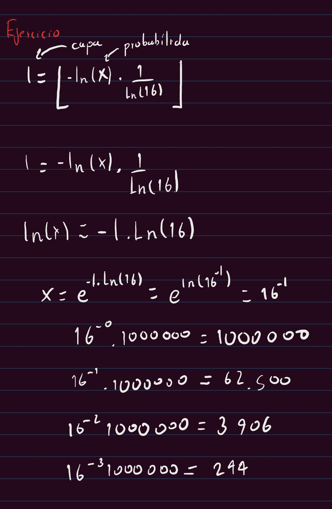
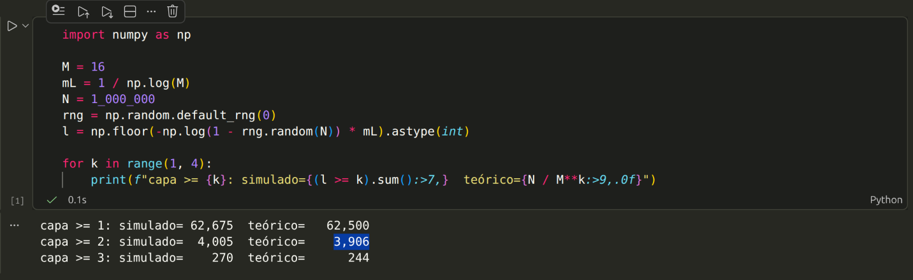

# Respuestas del workshop RAG
Escribe aquí tus respuestas con tus propias palabras. Pega tablas, resultados y enlaces a las capturas de `evidencias/`.

---

# Bloque 0 · Teoría

## T1 · Cuántos nodos viven en cada capa

_Evidencia:_ 

_Mi respuesta / análisis:_ Porque la complejidad algoritmica depende de los nodos visitados entonces entre menos nodos se visiten menos tiempo demora. Asi las capas superiores funcionan como ruta rapida hacia zonas inferiores.

## T2 · ef, k y el tamaño de la cola

_Evidencia:_ …

_Mi respuesta / análisis:_ 
1. Cuando la cantidad de candidatos ef es menor que los candidatos solicitados k, simplemente no hay k candidatos que elegir. 
2. Empieza con _ef = 2* k_ y si el _recall_ es insuficiente subelo.
3. Puedes cambiar el _ef_ utilizado para el esfuerzo en la busqueda y en teoria y si la implementacion lo permite puedes cambiar *ef_construction* lo cual modificaria la calidad de los enlaces o el _recall_. Pero esto no es apropiado e introduce ambiguedad en la medicion del _recall_ entonces en definitiva deberiamos cambiar _ef_ y no *ef_construction*.

## T3 · Inserción frente a búsqueda

_Evidencia:_ 

| Comparacion | Inserción | Búsqueda |
| --- | --- | --- | 
|¿Se sortea la capa? | Si, basado en una distribucion exponencial | No, cada nodo ya tiene capa asignada |
|Valor de ef en las capas altas | _ef = 1_ mientras no se haya llegado a la capa maxima del nodo insertado, _ef = ef_construction_ despues | Excepto en la capa 0 _ef = 1_ segun la guia, en la capa 0 se recomienda _ef=2*k_ |
|Parámetro de la fase principal | _mL≈ 1 / ln(16) =controla la distribucion_, *ef_construction=candidatos del greedy en construccion*, _M=mejore candidatos_ | _ef=candidatos de la busqueda_, _k=mejores candidatos seleccionados_, _query_vector_ |
|¿Modifica el índice? | Si | No |

_Mi respuesta / análisis:_ *vectorstore.add_documents(...)* en insercion y *retriever.invoke(...)* en busqueda 

## T4 · El invariante de FAISSVectorStore

_Evidencia:_ …

_Mi respuesta / análisis:_
1. Esta busqueda ahora da un error porque si la base de datos vectorial da el indice _3_, y el proceso de busqueda termina llamando a _self.documents_ en esa posicion estas llamando un indice invalido y arroja error.

2. Si hay un error silencios es porque se retorno -1 debido a que no se pudo llenar los k candidatos, y por lo tanto el problema esta en el tercer indice que al extraer de _self.document_ seria igual al ultimo document insertado. 

3. La base de datos vectorial Qdrant se encarga de manjer las mutaciones de forma nativa, mientras que FAISS no tiene las operaciones que hacen falta para esto.

## T5 · El costo de la fuerza bruta

_Evidencia:_ …

_Mi respuesta / análisis:_

---

# Bloque A · App RAG empresarial

## A1 · Ejecuta la app RAG de punta a punta

_Evidencia:_ …

_Mi respuesta / análisis:_

## A2 · Tu propio corpus de documentos

_Evidencia:_ …

_Mi respuesta / análisis:_

## A3 · Ingeniería del prompt (antes y después)

_Evidencia:_ …

_Mi respuesta / análisis:_

## A4 · Muestra el score de similitud en las fuentes

_Evidencia:_ …

_Mi respuesta / análisis:_

---

# Bloque B · RAG sobre papers

## B1 · Ejecuta el RAG de papers y evalúa con el ground truth

_Evidencia:_ …

_Mi respuesta / análisis:_

## B2 · Experimentos con chunk_size, k y score_threshold

_Evidencia:_ …

_Mi respuesta / análisis:_

## B3 · Preguntas trampa: ¿el RAG admite que no sabe?

_Evidencia:_ …

_Mi respuesta / análisis:_

## B4 · Preguntas en español sobre papers en inglés

_Evidencia:_ …

_Mi respuesta / análisis:_

## B5 · Escribe tu propio quiz con ground truth

_Evidencia:_ …

_Mi respuesta / análisis:_

---

# Reflexión

## R1 · Reflexión final con tus datos

_Evidencia:_ …

_Mi respuesta / análisis:_

---

# Retos

## C1 · HNSW contra fuerza bruta con FAISS

_Evidencia:_ …

_Mi respuesta / análisis:_

## C2 · Un tercer paper: el RAG que explica HNSW

_Evidencia:_ …

_Mi respuesta / análisis:_

## C3 · App Gradio para los papers con filtro por paper

_Evidencia:_ …

_Mi respuesta / análisis:_

## C4 · Evaluación automática de la recuperación

_Evidencia:_ …

_Mi respuesta / análisis:_

## C5 · MMR frente a similitud pura

_Evidencia:_ …

_Mi respuesta / análisis:_

## C6 · Persistencia del índice en disco

_Evidencia:_ …

_Mi respuesta / análisis:_

